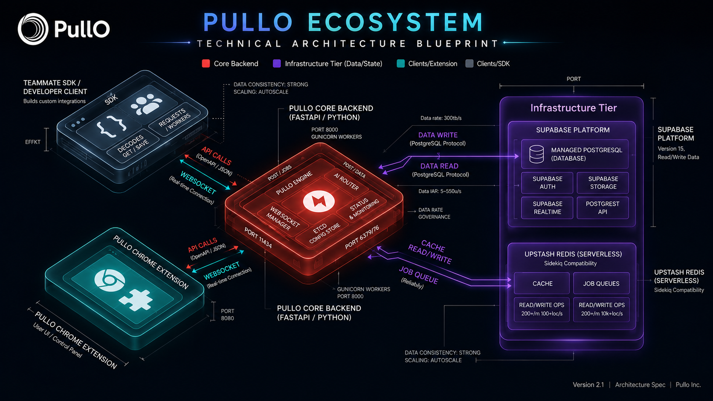
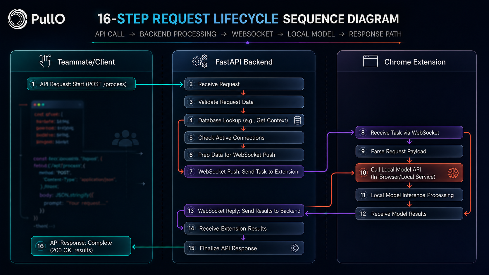

# PullO

## Turn Your Local AI Into a Team Asset

PullO is a private AI network layer that lets teams share local models (Ollama, LM Studio, llama.cpp) as secure, OpenAI-compatible APIs — without exposing infrastructure, paying cloud inference bills, or managing complex networking.

<div align="center">
  
</div>

### The Problem

Sharing local AI models with a team is still a networking headache. Port forwarding exposes your entire machine. Tools like ngrok expose raw URLs without API key scoping, per-model access control, or usage tracking. Teams end up stitching together SSH jump boxes, VPN configs, and reverse proxies — barely keeping it together until someone changes their IP or the tunnel drops.

### The Solution

PullO replaces the entire networking layer with a **pull-based model**. A lightweight browser extension on your machine establishes a single persistent outbound WebSocket connection to PullO's cloud relay. The extension polls for incoming requests.

When a teammate calls your model via the OpenAI-compatible API, the request is authenticated, validated, and forwarded over that WebSocket to your extension. The extension calls your local provider (Ollama, LM Studio, llama.cpp, or any OpenAI-compatible endpoint), streams the response back through the relay, and the caller receives a standard OpenAI response — without ever knowing where the model actually ran.

Your machine is never directly reachable. There are no open ports, no dynamic DNS, no VPN. The model stays local; only the API surface is shared.

### Why PullO

| | Traditional Tunneling (ngrok, Cloudflare) | PullO |
|---|---|---|
| **Connection model** | Inbound port forwarding (push) | Outbound WebSocket polling (pull) |
| **Firewall compatibility** | Blocked by corporate proxies | Works behind any NAT/proxy |
| **Machine exposure** | Entire port exposed to the internet | Zero inbound ports; machine unreachable |
| **Auth model** | Single URL, no built-in auth | Scoped API keys per workspace, per model |
| **Multi-user sharing** | Share a raw URL | Role-based team workspaces |
| **Usage tracking** | None | Per-request analytics, token counts, rate limits |
| **Provider support** | Web services only | Ollama, LM Studio, llama.cpp, OpenAI-compatible |
| **Streaming** | Depends on the tunnel | Native SSE streaming end-to-end |

---

## Features

| Icon | Feature | Description |
|------|---------|-------------|
| 🔌 | **OpenAI-Compatible API** | Drop-in replacement — use existing OpenAI SDKs without changing your application code |
| 🖥️ | **Browser Extension** | Lightweight Chrome extension establishes a secure outbound connection from your machine |
| 🧠 | **Local Provider Support** | Works with Ollama, LM Studio, and llama.cpp out of the box; any OpenAI-compatible endpoint works |
| 👥 | **Team Workspaces** | Organize members into isolated workspaces with shared model infrastructure and role-based access |
| 🔑 | **Scoped API Keys** | Generate keys with model-level access, tool permissions, rate limits, and usage controls |
| 📊 | **Usage Analytics** | Track requests, tokens, active models, and team activity per workspace |
| 📜 | **Request Logs** | Inspect individual AI requests for debugging and monitoring (prompts are never stored) |
| 🔒 | **Zero Inbound Ports** | Pull-based architecture means no open ports, no dynamic DNS, no VPN configuration |
| 🛠️ | **Browser Runtime Tools** | Extension injects browser capabilities — search, read, screenshot — as LLM tool calls |

---

## Screenshots

<details>
<summary><b>Landing Page</b></summary>
<br>


*Screenshot coming soon.*

</details>

<details>
<summary><b>Dashboard</b></summary>
<br>


*Screenshot coming soon.*

</details>

<details>
<summary><b>Models</b></summary>
<br>


*Screenshot coming soon.*

</details>

<details>
<summary><b>API Keys</b></summary>
<br>


*Screenshot coming soon.*

</details>

<details>
<summary><b>Analytics</b></summary>
<br>


*Screenshot coming soon.*

</details>

<details>
<summary><b>Browser Extension</b></summary>
<br>


*Screenshot coming soon.*

</details>

<details>
<summary><b>Workspace</b></summary>
<br>


*Screenshot coming soon.*

</details>

---

## Demo

🎥 Demo video — coming soon.

---

## Architecture

### High-Level System



```
                     ┌──────────────────────┐
                     │     Your Team Apps    │
                     │  (OpenAI SDK / Curl   │
                     │   / LangChain / ...)  │
                     └──────────┬───────────┘
                                │ pk_xxx API key
                     ┌──────────▼───────────┐
                     │    PullO Cloud Relay   │
                     │                        │
                     │  ┌──────────────────┐  │
                     │  │ Auth + Rate Limit│  │
                     │  │ + Request Queue  │  │
                     │  └────────┬─────────┘  │
                     └──────────┬───────────┘
                                │ WebSocket (outbound)
                     ┌──────────▼───────────┐
                     │  Chrome Extension     │
                     │  (pulls requests,     │
                     │   streams responses)  │
                     └──────────┬───────────┘
                                │ localhost
                     ┌──────────▼───────────┐
                     │    Local AI Runtime   │
                     │                        │
                     │  Ollama  │  LM Studio  │
                     │  llama.cpp │ Compatible │
                     └────────────────────────┘
```

### Request Lifecycle



```
┌─────────┐         ┌──────────┐         ┌───────────┐         ┌────────┐
│  Client │         │  PullO   │         │ Extension │         │ Local  │
│ (SDK)   │         │  Cloud   │         │ (Browser) │         │ Model  │
└────┬────┘         └────┬─────┘         └─────┬─────┘         └───┬────┘
     │                    │                     │                    │
     │  POST /v1/chat     │                     │                    │
     │  (Bearer pk_xxx)   │                     │                    │
     │───────────────────>│                     │                    │
     │                    │                     │                    │
     │                    │  Validate API key   │                    │
     │                    │  Check rate limit   │                    │
     │                    │  Check model online │                    │
     │                    │                     │                    │
     │                    │  Queue request      │                    │
     │                    │────────────────────>│                    │
     │                    │  (WebSocket push)   │                    │
     │                    │                     │                    │
     │                    │                     │  localhost:11434   │
     │                    │                     │───────────────────>│
     │                    │                     │                    │
     │                    │                     │  Generate response │
     │                    │                     │<───────────────────│
     │                    │                     │  (streaming SSE)   │
     │                    │  Stream response    │                    │
     │<───────────────────│                     │                    │
     │                    │                     │                    │
```

### Security Model

```
                          ┌──────────────────┐
                          │   Internet       │
                          │                  │
                          │  PullO Cloud     │
                          │  (reachable)     │
                          └────────┬─────────┘
                                   │
                     Only outbound │ WebSocket
                     No inbound    │
                     ports open    │
                                   │
                          ┌────────▼─────────┐
                          │   Your Machine   │
                          │                  │
                          │  ┌────────────┐  │
                          │  │ Extension  │  │
                          │  │ (Chrome)   │  │
                          │  └────────────┘  │
                          │         │        │
                          │  ┌──────▼─────┐  │
                          │  │ Ollama /   │  │
                          │  │ LM Studio  │  │
                          │  │ (localhost)│  │
                          │  └────────────┘  │
                          └──────────────────┘
```

---

More architecture diagrams — including backend server structure, extension internals, and detailed flowcharts — are available in the [diagrams/](./diagrams) directory.

## Tech Stack

PullO's public-facing and client-side components are built with:

| Layer | Technology |
|-------|-----------|
| **Frontend** | Next.js, React 19, TypeScript |
| **Styling** | Tailwind CSS 4, shadcn/ui, Framer Motion |
| **3D / Visuals** | Three.js, React Three Fiber, GSAP, Lenis |
| **Auth (frontend)** | Supabase Auth (email + Google OAuth) |
| **Charts** | Recharts |
| **Docs** | Next.js 15, MDX, Fuse.js search |
| **Browser Extension** | Manifest V3 (Chrome) |
| **Local Providers** | Ollama, LM Studio, llama.cpp (any OpenAI-compatible endpoint) |
| **Analytics** | Vercel Analytics |
| **Error Monitoring** | Sentry |
| **Icons** | Lucide React |

---

## Quickstart / API Example

PullO exposes a standard OpenAI-compatible API. Use any OpenAI SDK by changing the base URL and API key.

```bash
curl https://api.pullo.ai/v1/chat/completions \
  -H "Authorization: Bearer pk_xxxxxxxxx" \
  -H "Content-Type: application/json" \
  -d '{"model":"deepseek-r1","messages":[{"role":"user","content":"Hello!"}]}'
```

```python
from openai import OpenAI

client = OpenAI(
    base_url="https://api.pullo.ai/v1",
    api_key="pk_xxxxxxxxx"
)

response = client.chat.completions.create(
    model="deepseek-r1",
    messages=[{"role": "user", "content": "Hello!"}]
)

print(response.choices[0].message.content)
```

### Repository Structure

- `README.md` - Project overview
- `LICENSE.md` - License information
- `backend/` — Backend platform documentation
- `frontend/` — Landing page and dashboard application
- `diagrams/` — Architecture and flow diagrams
- `branding/` — Logo and brand assets
- `media/` — Press kit and promotional materials
- `pitch/` — Investor materials
- `examples/` — Code examples and integration guides

### Documentation

Live docs site: [pullo-docs.vercel.app](https://pullo-docs.vercel.app)

### Roadmap

High-level product direction and upcoming features.

### Team

Built by a developer-focused team.

### FAQ

General questions about PullO functionality and usage.