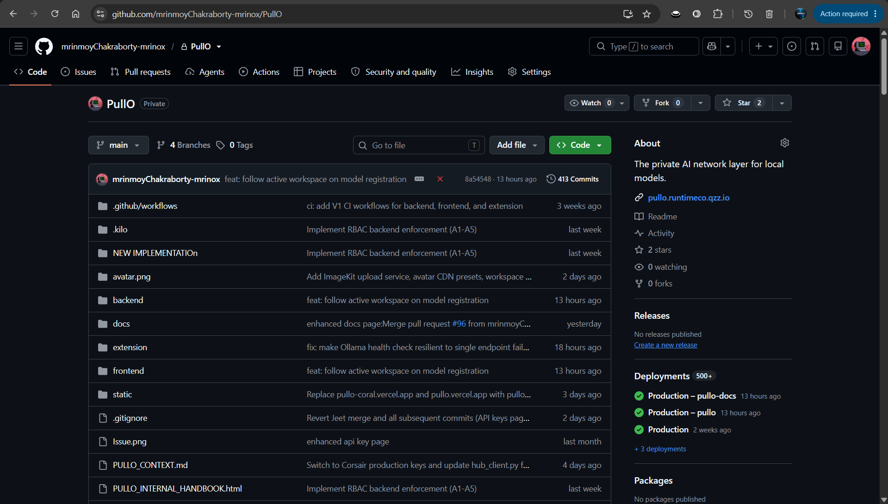

# PullO Evidence

Materials related to the PullO project.

## About PullO

PullO is a private AI network layer that enables teams to share local models securely without exposing infrastructure. Models run locally; only API access is shared.

## Verification

Evidence materials are provided for evaluation purposes. Source code and internal details remain proprietary.

## Screenshot Previews

## Purpose

Materials provided for evaluation purposes only.

---

*This evidence is provided for evaluation purposes only. Source code remains proprietary.*